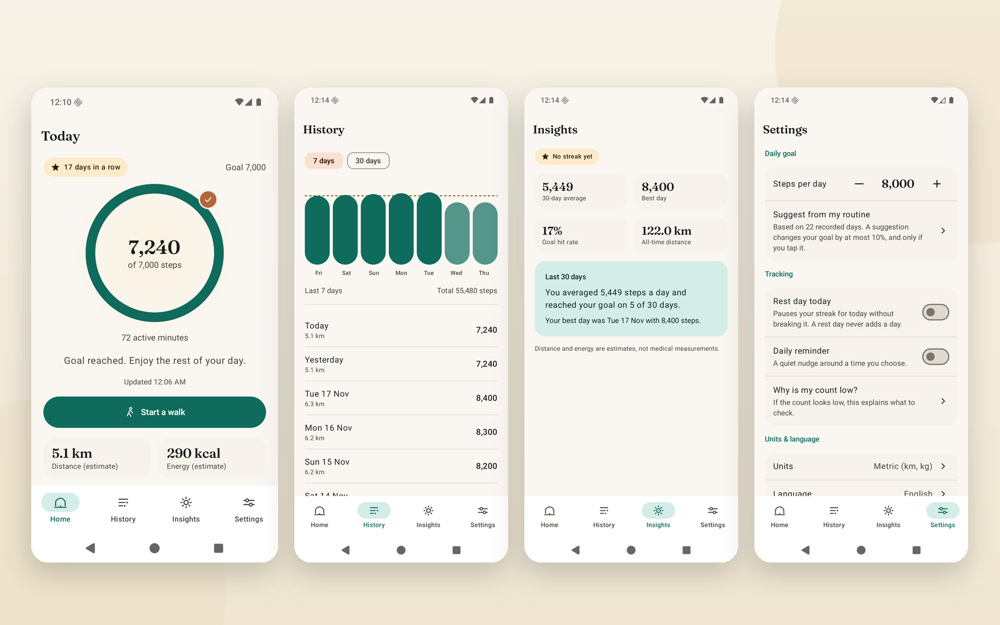
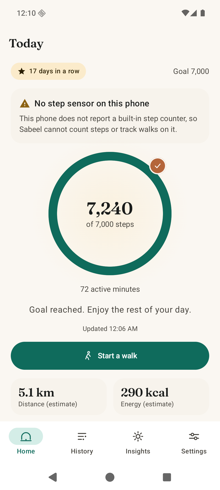
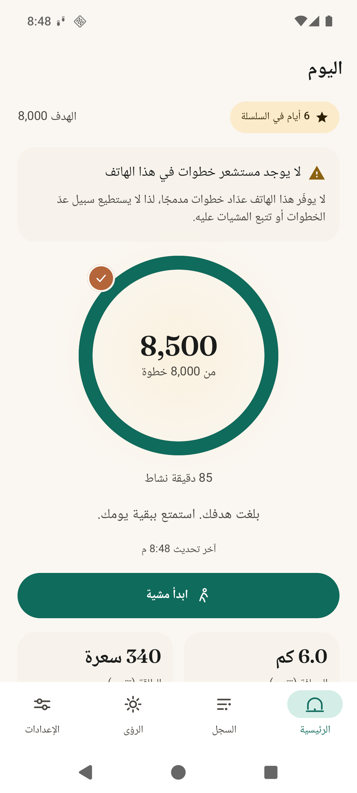
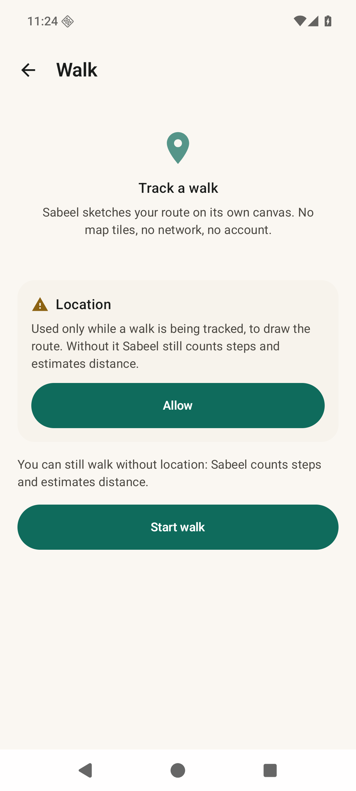
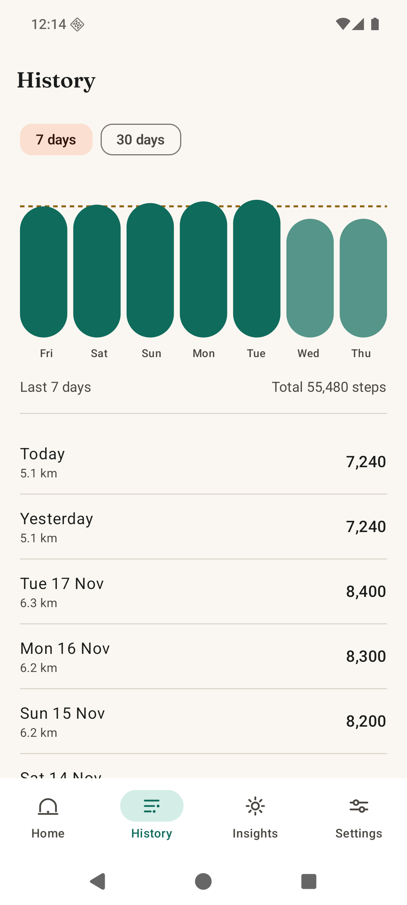
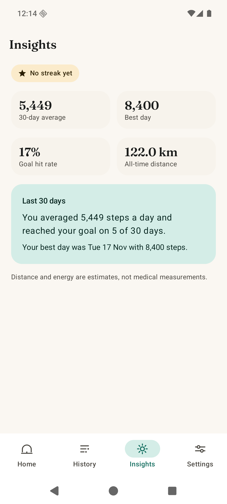

# سبيل (Sabeel) — عدّاد خطوات ومتتبّع مشي يعمل دون إنترنت

**تطبيق أندرويد لعدّ الخطوات (pedometer) وتتبّع المشي والجري، يعمل دون إنترنت، بلا إعلانات وبلا حساب — ولا يطلب إذن `INTERNET`. الواجهة بالعربية والإنجليزية.**

[](https://github.com/ahmadmhmdsy/sabeel-steps/releases/latest)
[](LICENSE)
[-3DDC84?logo=android&logoColor=white)](#التوافق)
[](#البنية-المعمارية)
[](#البنية-المعمارية)
[](https://github.com/ahmadmhmdsy/sabeel-steps/actions/workflows/android.yml)
[](#حالة-التحقق)

[English](README.md) | **العربية**

> **ملاحظة حول اللغة:** هذه نسخة عربية كاملة من الـ README الإنجليزي، كُتبت بعناية بمحتوى مطابق، لكنها **لم تُراجَع بعد من متحدث عربي أصلي**؛ المراجعة اللغوية إلزامية قبل اعتماد الصفحة العربية.

<p align="center">
  
</p>

*صورة تعريفية توضيحية — نموذج تصميمي للواجهة الإنجليزية، وليست لقطة شاشة من بيانات جهاز مقيسة ولا دليلًا على جهاز. أما لقطات المحاكي الحقيقية فهي في [لقطات الشاشة](#لقطات-الشاشة).*

**سبيل** تطبيق أندرويد أصلي مفتوح المصدر (رخصة Apache-2.0) يعدّ الخطوات ويتتبّع المشي والجري، ويُبقي كل شيء على هاتفك. لا يحتوي البيان المدمج (merged manifest) لنسخة الإصدار على إذن **`INTERNET`**، فلا يستطيع التطبيق إرسال بياناتك إلى أي مكان: لا خادم، ولا حساب، ولا شبكة إعلانات، ولا تحليلات، ولا حزمة إبلاغ عن الأعطال. مجموعة المزايا صغيرة وصريحة: خطوات اليوم مقابل هدف شخصي، وسجل 7/30 يومًا، ورؤى، وجلسات مشي أو جري اختيارية بمسار أمامي اختياري، وأماكن وإعدادات محفوظة محليًا، وتذكيرات، وشاشة تشخيص تقول لك هل العدّ يعمل فعلًا. والواجهة **بالعربية والإنجليزية**.

- **اسم الحزمة / applicationId:** `com.sabeel.steps`
- **الإصدار:** 1.3.0 (versionCode 3) — انظر [`app/build.gradle.kts`](app/build.gradle.kts)
- **آلية التوزيع:** **إصدارات GitHub فقط.** لم يُنشر سبيل على **Google Play**؛ لا توجد صفحة متجر، ولا يُدّعى أي قبول أو موافقة من Google Play.
- **المنصّة:** أندرويد 8.0 فأحدث (minSdk 26)؛ compileSdk/targetSdk 36.
- **التقنيات:** Kotlin 2.0.21 · Jetpack Compose (Material 3) · Room v3 (KSP) · DataStore · WorkManager · Navigation-Compose · AGP 8.10.1 · Gradle wrapper 8.11.1 · JDK 21.
- **الرخصة:** Apache-2.0 — [LICENSE](LICENSE) و[NOTICE](NOTICE) و[إشعارات الأطراف الثالثة](app/src/main/assets/THIRD-PARTY-NOTICES.txt).
- **موقع المشروع:** <https://ahmadmhmdsy.github.io/sabeel-steps/>

## لماذا سبيل؟

- **يعمل دون إنترنت بحكم التصميم لا بحكم الوعود.** لا يحتوي بيان الإصدار على إذن `INTERNET` ولا على شيفرة شبكة. يستطيع أي شخص التحقق من ذلك في ملف APK أو في البيان المدمج؛ فالخصوصية هنا لا تعتمد على مفتاح في الإعدادات.
- **بلا إعلانات، وبلا حسابات، وبلا تتبّع.** لا حزمة إعلانات، ولا تحليلات، ولا مُبلّغ أعطال، ولا مزامنة سحابية، ولا اشتراكات. النسخ الاحتياطي السحابي في أندرويد معطّل (`allowBackup="false"`)، فلا تُنسخ بيانات خطواتك إلى خوادم Google أيضًا.
- **بياناتك تبقى لك.** كل السجلات في التخزين الخاص بالتطبيق. تستطيع تصدير إجماليات الأيام بنفسك عبر منتقي الملفات في النظام، وحذف كل شيء من الإعدادات؛ وإزالة التطبيق تحذف كل شيء.
- **مصادر خطوات متعددة تُدمج بصدق.** عدّاد الخطوات العتادي + كاشف الخطوات + إجمالي Health Connect الاختياري للقراءة فقط + تقدير من مقياس التسارع موسوم بوضوح. لكل مصدر سجلّه المستقل، واليوم هو أعلى قيمة بين الأدلة، والفراغات تُوسم بـ «≈» ولا تُختلق.
- **يعترف بما لا يستطيعه.** قد يوقف أندرويد أو مدير بطارية متشدّد عدّ الخدمة الأمامية في بعض الهواتف؛ يسجّل سبيل محاولة التشغيل عند الإقلاع، ويشرح ما حدث في شاشة التشخيص، ولا يدّعي أبدًا أن العدّ «لا يتوقف».
- **صغير وموقّع وقابل لإعادة البناء من المصدر.** ملف APK للإصدار 1.3.0 حجمه **2,138,010 بايت (2.04 ميبي بايت)**، وموقّع، وبصمة SHA-256 منشورة؛ ويمكنك إعادة بنائه بالأوامر الموثّقة.
- **العربية والإنجليزية.** تخطيطات RTL ونصوص مترجمة، لكن المراجعة العربية الأصلية ما زالت معلّقة (انظر [حدود صريحة](#حدود-صريحة)).
- **مفتوح المصدر.** رخصة Apache-2.0؛ الشيفرة الكاملة بلغة Kotlin والاختبارات والوثائق القانونية وأدلة الإصدار في هذا المستودع.

## المحتويات

- [لماذا سبيل؟](#لماذا-سبيل)
- [التنزيل والتثبيت](#التنزيل-والتثبيت)
- [لقطات الشاشة](#لقطات-الشاشة)
- [المزايا](#المزايا)
- [الخصوصية والأمان](#الخصوصية-والأمان)
- [البنية المعمارية](#البنية-المعمارية)
- [البناء والاختبار والفحص](#البناء-والاختبار-والفحص)
- [حالة التحقق](#حالة-التحقق)
- [التوافق](#التوافق)
- [حدود صريحة](#حدود-صريحة)
- [ما لم يُضمَّن عن قصد](#ما-لم-يُضمَّن-عن-قصد)
- [خريطة الوثائق](#خريطة-الوثائق)
- [المساهمة والأمان](#المساهمة-والأمان)
- [الأسئلة الشائعة](#الأسئلة-الشائعة)
- [الرخصة](#الرخصة)

## التنزيل والتثبيت

**أحدث إصدار:** <https://github.com/ahmadmhmdsy/sabeel-steps/releases/latest>

تحتوي صفحة كل إصدار على الملفات الموقّعة ومجاميع التحقق:

| الملف | ما هو | استخدامه |
|---|---|---|
| `Sabeel-1.3.0-release.apk` | حزمة APK موقّعة للإصدار (R8 مع تصغير الموارد) | التثبيت على هاتف |
| `Sabeel-1.3.0-release.aab` | حزمة تطبيق أندرويد (App Bundle) موقّعة | أدوات الحزم / رفع مستقبلي إلى Play — **لا تُثبَّت بالأمر `adb install`** |
| `SHA256SUMS.txt` | مجاميع SHA-256 لكل ملفات 1.3.0 | التحقق من سلامة التنزيل |

مجاميع التحقق نفسها محفوظة في [`dist/SHA256SUMS.txt`](dist/SHA256SUMS.txt) (ملفات APK/AAB نفسها ليست مرفوعة في Git؛ بل تُبنى من المصدر).

### التحقق من التنزيل

```powershell
# Windows PowerShell
Get-FileHash .\Sabeel-1.3.0-release.apk -Algorithm SHA256
```

```bash
# Linux / macOS
sha256sum -c SHA256SUMS.txt
```

يجب أن يطبع ملف APK للإصدار:

```
487ee9c9f7e7d0e1bbe490c4b7692c72cb83c0f8d963cf1f2a4545677a4dfe5d  Sabeel-1.3.0-release.apk
```

### التثبيت اليدوي (sideload) عبر adb

```bash
adb install -r Sabeel-1.3.0-release.apk
```

تحذيرات التثبيت اليدوي، بصراحة:

- هذا **ليس** تثبيتًا من متجر Play. لا توجد صفحة متجر ولا قناة تحديث تلقائي؛ وعند صدور إصدار جديد نزّل ملف APK الجديد وثبّته فوق القديم (المفتاح نفسه، فيُحدَّث في مكانه).
- تحتاج إلى تفعيل تصحيح USB، أو السماح لمدير الملفات بـ«تثبيت التطبيقات من مصادر غير معروفة». وقد يُظهر أندرويد تحذير المصدر غير المعروف وتنبيه Play Protect المعتادين لأي تطبيق يُوزَّع خارج المتجر.
- استخدم `adb install` وليس `adb sideload`؛ فالثاني خاص بصور الاسترداد/التحديث الكاملة (OTA) وليس تثبيتًا عاديًا لتطبيق.
- يتطلّب أندرويد 8.0 (API 26) فأحدث.

## لقطات الشاشة

| | | |
|---|---|---|
|  |  |  |
|  |  | |

**هذه لقطات محاكي** بدقة 1080×2400 من صورة الاختبار **API 36 AOSP-ATD** المستخدمة في ضمان الجودة لهذا المشروع. لا تحتوي هذه الصورة على **مستشعر خطوات عتادي ولا كاشف خطوات**، ولذلك تعرض الشاشة الرئيسية تنبيه «لا يوجد مستشعر خطوات» بدل الخطوات الحقيقية، واستُخدم في بعض جولات ضمان الجودة مُحقِّن خطوات خاص بنسخ التصحيح (debug). اللقطات تعرض واجهة حقيقية وتخطيطات حقيقية، لكنها **ليست دليلًا على عدّ خطوات فعلي**، و**لا توجد لقطات شاشة من جهاز حقيقي للإصدار 1.3 حتى الآن**.

## المزايا

*كل ما يلي موجود في بناء الإصدار 1.3.0. والمزايا التي جُرِّبت على نسخ التصحيح أو على المحاكي فقط موسومة بذلك؛ انظر [حالة التحقق](#حالة-التحقق).*

### التحكم في العدّ وأدلة إعادة التشغيل

- **مفتاح تشغيل/إيقاف محفوظ واحد** لعدّ الخطوات، تشترك فيه حلقة الرئيسية وشريط الحالة أسفلها والإعدادات — إنه المفتاح نفسه في كل مكان، بدور «مفتاح» لقارئ الشاشة TalkBack. ويبقى اختيارك بعد إعادة التشغيل وبعد إغلاق التطبيق.
- عند إيقاف العدّ، لا تكون خدمة العدّ عاملة، والواجهة تقول ذلك؛ وتفرّق شاشة التشخيص بين «موقوف بقرار المستخدم» و«أوقفه النظام».
- **أدلة إعادة التشغيل:** بعد إعادة تشغيل الهاتف يسجّل `BootReceiver` محاولة التشغيل (الأعلام، وأذونات النشاط وHealth Connect، والمستشعر، والنتيجة، وهل كانت الخدمة حية بعد الفحص) ويحاول استئناف العدّ إن كان مشغّلًا. وإذا منع أندرويد البدء في الخلفية، يسجّل التطبيق ذلك وقد يرسل **إشعار تعافٍ واحدًا** هادئًا. وتعرض شاشة التشخيص آخر عشر محاولات.
- **مشاركة التشخيص:** تقرير نصي لا يحتوي بيانات موقع أو أماكن محفوظة.
- **زر «إعادة تشغيل العدّ»** بضغطة واحدة في شاشة التشخيص.

### مصادر الخطوات

- يعمل كلٌّ من `TYPE_STEP_COUNTER` و`TYPE_STEP_DETECTOR` بالتوازي داخل خدمة أمامية من نوع الصحة (health foreground service).
- **Health Connect** (اختياري، للقراءة فقط، ومعطّل افتراضيًا) يضيف إجمالي خطوات اليوم المتزامن كحدّ أدنى مطلق؛ وهناك قراءة خلفية اختيارية مشروطة بدعم الجهاز تُبقي هذا الإجمالي محدَّثًا. وسبيل **لا يكتب أبدًا** في Health Connect.
- **تقدير من مقياس التسارع** موسوم بوضوح، ولا يملأ إلا الجزء الذي لم يره مصدر مقيس أو متزامن. لكل مصدر سجلّه المستقل، ولا يُبدَّل مصدر ولا تُعاد قاعدته؛ واليوم هو أعلى قيمة بين الأدلة.
- تُكتشف إعادة التشغيل وإعادة ضبط المستشعر من هبوط القيمة الخام؛ وتُرفض القفزات المستحيلة؛ ويُستعاد ما فات العدّاد بعد موت العملية من القيمة التراكمية الخام. وتُشتق علامة «≈» من السجلات وتُحفظ مع اليوم.

### جلسات المشي والجري

- ابدأ جلسة مشي أو جري من الرئيسية بهدف اختياري: وقت، أو خطوات، أو مسافة، أو الوصول إلى **مكان محفوظ**.
- مسار ومسافة اختياريان في المقدمة فقط، يُسجَّلان ما دامت شاشة الجلسة مفتوحة وفقط بوجود إذن الموقع؛ مع إيقاف مؤقت واستئناف دون تعويض رجعي للفترة المتوقفة؛ ثم إنهاء وحفظ أو إلغاء.
- **جلسة نشطة واحدة في كل وقت**؛ والجلسات التي تعبر منتصف الليل تُقسَّم إلى مقاطع.
- خطوات الجلسة **إسقاط من إجمالي اليوم نفسه**، وليست عدّادًا ثانيًا — `session.steps ≤ daily.steps` بحكم التصميم.
- **الإعدادات المحفوظة (presets)** تعيد استخدام إعداد جلسة معتاد. و**الأماكن** المحفوظة هي اسم + خط عرض/طول + نصف قطر (25–1000 متر) مع رابط خرائط خارجي؛ لا بحث عن العناوين، ولا تحويل جغرافي، ولا تنزيل بلاطات خرائط.
- **تصدير الجلسات:** «تصدير كل الجلسات (CSV)» و«تصدير GPX» لكل جلسة عبر منتقي الملفات في النظام — موجود في البناء وجُرِّب على بناء تصحيح في المحاكي، ولم يُتحقَّق بعد على بناء الإصدار الموقّع أو على هاتف.

### الرئيسية والسجل والرؤى

- **الرئيسية:** حلقة تقدّم مقابل هدفك الشخصي، وخطوات اليوم، والمسافة، والدقائق النشطة، وسلسلة الأيام، وأعمدة آخر سبعة أيام. والحلقة هي مفتاح العدّ.
- **السجل:** سجل 7/30 يومًا مع خط الهدف، وقائمة يومية، وجلساتك المحفوظة بتسمياتها وعمليات تصديرها.
- **الرؤى:** متوسطات النافذة، وأفضل يوم، ونسبة بلوغ الهدف، وإجمالي المسافة.

### التذكيرات والإشعارات والإعدادات

- تذكيرات عبر WorkManager، وإشعار بلوغ الهدف اليومي يمكنك الضغط عليه لفتح التطبيق (مع مراعاة `POST_NOTIFICATIONS`؛ ورفض الإذن لا يُسقط التطبيق).
- **الإعدادات:** مفتاح العدّ، والهدف اليومي، والوحدات، والتذكير، وبيانات الجسم المستخدمة في التقديرات، واللغة (العربية/الإنجليزية)، وتصدير/استيراد CSV لإجماليات الأيام عبر منتقي الملفات في أندرويد، و**حذف جميع البيانات**.
- شاشتا **الخصوصية** و**حول** توضّحان ما يُخزَّن على الجهاز وما يستطيع التطبيق فعله وما لا يستطيعه.
- **اللغة:** واجهة كاملة بالعربية والإنجليزية، بما في ذلك شاشات الجلسات الجديدة.

## الخصوصية والأمان

**الادعاء القابل للإثبات:** البيان المدمج لبناء الإصدار **لا يحتوي إذن `INTERNET`** ولا `ACCESS_NETWORK_STATE`؛ ولا خادم، ولا نظام حسابات، ولا إعلانات، ولا تحليلات، ولا حزمة إبلاغ عن الأعطال، ولا مزامنة سحابية. لا يستطيع سبيل نقل بياناتك — فليست لديه وسيلة نقل ولا إذن لبنائها.

### الأذونات التي يستخدمها التطبيق

| الإذن | لماذا | ملاحظات |
|---|---|---|
| `ACTIVITY_RECOGNITION` (وقت التشغيل، API 29+) | قراءة عدّاد/كاشف الخطوات العتادي | يُشرح قبل نافذة النظام؛ ميزة أساسية |
| `POST_NOTIFICATIONS` (وقت التشغيل، API 33+) | التذكيرات، وإشعار الهدف، وإشعار الخدمة الأمامية للعدّ | اختياري؛ الرفض لا يُسقط التطبيق |
| `ACCESS_FINE_LOCATION` / `ACCESS_COARSE_LOCATION` (وقت التشغيل) | مسار/مسافة اختياريان داخل جلسة تبدأها أنت | **في المقدمة فقط**؛ يُطلب عند بدء الجلسة؛ والرفض يُبقي الجلسة صالحة |
| Health Connect `READ_STEPS` (+ قراءة خلفية اختيارية مشروطة بالدعم) | مصدر اختياري للقراءة فقط لإجمالي خطوات اليوم المتزامن | معطّل افتراضيًا؛ لا يكتب أبدًا؛ قابل للإلغاء |
| `FOREGROUND_SERVICE` و`FOREGROUND_SERVICE_HEALTH` و`FOREGROUND_SERVICE_LOCATION` | خدمتا العدّ والجلسة النشطة تعرضان إشعارًا | أذونات عادية |
| `RECEIVE_BOOT_COMPLETED` | محاولة استئناف العدّ/التذكيرات بعد إعادة التشغيل وتسجيل المحاولة | إذن عادي؛ وقد يمنع أندرويد المحاولة |
| `WAKE_LOCK` | جدولة WorkManager | إذن تابع؛ لا يظهر للمستخدم |

**غائبة عن التصميم ومُتحقَّق منها في بيان الإصدار 1.3:** `INTERNET`، `ACCESS_NETWORK_STATE`، `ACCESS_BACKGROUND_LOCATION`، `BODY_SENSORS`، أذونات التخزين/الوسائط، أذونات المنبّهات الدقيقة، و`AD_ID`.

### معالجة البيانات

- تُخزَّن إجماليات الخطوات والجلسات/المقاطع والمسارات والأماكن والإعدادات المحفوظة والتفضيلات في التخزين الخاص بالتطبيق (Room + DataStore)، ويحميها عزل تطبيقات أندرويد (sandbox)؛ ولا يضيف التطبيق طبقة شبكة أو سحابة خاصة به.
- **النسخ الاحتياطي السحابي في أندرويد معطّل** (`allowBackup="false"`).
- **Health Connect للقراءة فقط واختياري**: يقرأ سبيل إجمالي اليوم فقط، ولا يكتب أبدًا، ويمكن إلغاء الإذن من تطبيق Health Connect أو من إعدادات أندرويد في أي وقت.
- **الموقع في المقدمة فقط**: لا تسجيل موقع في الخلفية، ولا سياج جغرافي، ولا تحديد موقع عند الإقلاع، ولا طلبات خرائط أو تحويل جغرافي.
- **البيانات الوحيدة التي تخرج من التطبيق هي ملف تصدّره أنت بنفسك** (CSV لإجماليات الأيام، أو CSV/GPX للجلسات حيث يتوفر) عبر منتقي الملفات في أندرويد. ولا يستلم المطوّر نسخة منه أبدًا.
- **حذف جميع البيانات** في الإعدادات يزيل قاعدة البيانات (الخطوات اليومية والجلسات/المقاطع والمسارات والأماكن والإعدادات المحفوظة) والتفضيلات والملفات؛ وإزالة التطبيق تحذف كل شيء. ولا يوجد حساب، فلا حاجة إلى مسار حذف حساب.
- **لا قياسات عن بُعد:** لا تحليلات ولا تقارير أعطال بحكم التصميم. وبلاغات الأخطاء يدوية.

### سلامة الإصدار

- تُبنى نسخ الإصدار بتصغير R8 وتصغير الموارد، وتُوقَّع بمفتاح الرفع الخاص بالمشروع (نظام توقيع APK v2؛ بصمة شهادة SHA-256 `7b12ad6b…6152d`). ويُوقَّع ملف AAB بالمفتاح نفسه.
- حجم كل ملف وبصمة SHA-256 منشوران (انظر [حالة التحقق](#حالة-التحقق))؛ تحقّق قبل التثبيت.
- إجراءات التوقيع وسياسة حفظ المفاتيح: [`docs/release/KEYSTORE.md`](docs/release/KEYSTORE.md). ولا تُرفع الأسرار إلى Git أبدًا.
- سياسة الأمان والإبلاغ الخاص عن الثغرات: [SECURITY.md](SECURITY.md).

## البنية المعمارية

```
app/src/main/java/com/sabeel/steps/
  domain/     pure Kotlin: models, step math, step pipeline, window math
  domain/session/  activity/goal types, place/preset/leg models, projection rules
  data/       Room DB + DAOs (v3), repositories, DataStore settings, CSV codec/IO,
              export/session folder (SessionExport CSV/GPX builders)
  service/    StepCounterService (health FGS), WalkTrackingService (location|health FGS),
              WalkTracker (live state + checkpoint), CountingController (persisted intent),
              SessionConfig (session request carried in the service Intent)
  platform/   permissions, notifications, reminders/workers, BootReceiver,
              BootHealthWorker, CountingStore, service status store
  ui/         Compose theme/components/screens, view models, i18n (EN/AR)
app/src/debug/  DebugStepReceiver — debug-only step injector for emulator QA
app/src/test/   JVM unit tests (pipeline, math, CSV, session projection/export, cadence)
```

*شجرة المجلدات كما هي في المصدر، وتعليقاتها بالإنجليزية تبعًا للمشروع.*

**مسار البيانات:** أحداث المستشعرات ← `StepPipeline` (سجلات لكل مصدر، ويوم مدموج) ← `StepsRepository` (كتابة لقطة واحدة ذرّية) ← Room؛ ويُعاد اشتقاق خطوات الجلسة الحية من صفوف اليوم مع خط أساس خاص بها؛ أما إعدادات المستخدم فتُحفظ في DataStore. ولا شيء يخرج من الجهاز: لا إذن `INTERNET`، ولا شيفرة شبكة، ولا حزم خارجية.

**Room v3** يضيف جداول `Place` و`SessionPreset` و`WalkLeg` مع ترحيل `MIGRATION_2_3` المُصدَّر؛ ومخطط JSON محفوظ في المستودع، ولا يوجد رجوع تدميري (destructive fallback).

## البناء والاختبار والفحص

المتطلبات المسبقة: **JDK 21**، ومنصّة Android SDK 36 مع build-tools 36، وGradle wrapper المرفق (لا تثبّت Gradle منفصلًا). مثال على Windows PowerShell:

```powershell
$env:JAVA_HOME='C:\Program Files\Eclipse Adoptium\jdk-21.0.13.9-hotspot'
$env:ANDROID_HOME='C:\Android\Sdk'
$env:ANDROID_SDK_ROOT=$env:ANDROID_HOME

.\gradlew.bat --console=plain :app:assembleDebug          # debug APK
.\gradlew.bat --console=plain :app:testDebugUnitTest      # unit tests
.\gradlew.bat --console=plain :app:lintDebug              # lint gate (must be exit 0)
.\gradlew.bat --console=plain :app:assembleRelease        # release APK
.\gradlew.bat --console=plain :app:bundleRelease          # AAB for Play
```

المخرجات:

- ملف APK للتصحيح: `app/build/outputs/apk/debug/app-debug.apk`
- ملف APK للإصدار: `app/build/outputs/apk/release/app-release.apk`
- ملف AAB للإصدار: `app/build/outputs/bundle/release/app-release.aab`
- تقرير اختبارات الوحدة: `app/build/reports/tests/testDebugUnitTest/index.html`
- تقرير الفحص (lint): `app/build/reports/lint-results-debug.html`

**التكامل المستمر (CI):** يشغّل [`android.yml`](.github/workflows/android.yml) الأوامر `assembleDebug` و`testDebugUnitTest` و`lintDebug` و`bundleRelease` (غير موقّع) عند كل دفع إلى `main`؛ وتعرض الشارة حالة آخر تشغيل. والتكامل المستمر بوّابة بناء، وليس بديلًا عن جدول القياسات أدناه.

### الاختبار على المحاكي والخطوات الوهمية

لا تحتوي صورة **API 36 AOSP-ATD** على **مستشعر خطوات أو كاشف خطوات عتادي**، فلا يمكن التحقق من العدّ الحقيقي عليها؛ استخدم هاتفًا حقيقيًا لذلك (السكربت: [`docs/release/TEST-XIAOMI.md`](docs/release/TEST-XIAOMI.md)). وعلى نسخة **التصحيح فقط**، يحقن مستقبِل بثّ الخطوات عبر مسار اللقطة نفسه الذي تستخدمه الخدمة:

```powershell
adb shell am broadcast -a com.sabeel.steps.DEBUG_STEPS --ei steps 100 -n com.sabeel.steps/.debug.DebugStepReceiver
```

هذا المستقبِل غير موجود في نسخ الإصدار. وعلى المحاكي يمكن محاكاة الموقع بـ `adb emu geo fix <lon> <lat>`.

### توقيع الإصدار وعنوان سياسة الخصوصية

يُحمَّل توقيع الإصدار من `keystore.properties` فقط عند وجود الملف، لذلك يستطيع CI والنسخ الجديدة بناء ملفات إصدار غير موقّعة. الإجراء كامل في [`docs/release/KEYSTORE.md`](docs/release/KEYSTORE.md). أما رابط سياسة الخصوصية داخل التطبيق فهو حقل `BuildConfig` يُمرَّر وقت البناء بـ `-Psabeel.privacyPolicyUrl=…`؛ وبدونه تكون القيمة فارغة ويجب إبقاء الرابط مخفيًا. وخطوات الاستضافة: [`docs/privacy-site/FILL-AND-HOST.md`](docs/privacy-site/FILL-AND-HOST.md).

## حالة التحقق

**قِيسَ في 2026-11-23.** أُنتج بناء 1.3.0 في تشغيل Gradle متسلسل واحد على JDK 21 (Temurin 21.0.13)، ومنصّة Android SDK 36، وbuild-tools 36.0.0، وGradle wrapper 8.11.1، وAGP 8.10.1. ولم يُعَد بناء أي ملف إصدار بعد ذلك التشغيل. كل رقم أدناه مأخوذ من الأمر المذكور بجانبه؛ ولا يُنسخ أي عدد أو حجم أو بصمة من خطّة أو ادعاء.

| الفحص | النتيجة | الأمر / الدليل |
|---|---|---|
| اختبارات وحدة JVM | **205 اختبارًا، 18 حزمة، 0 إخفاق، 0 متجاوَز** (exit 0، 7 دقائق و14 ثانية) | `:app:testDebugUnitTest --no-daemon` |
| بوّابة الفحص (lint) | **0 أخطاء، 80 تحذيرًا، 2 تلميحًا** (exit 0، 6 دقائق و4 ثوانٍ) | `:app:lintDebug --no-daemon` |
| ملف APK للإصدار | **2,138,010 بايت (2.04 ميبي بايت)**، بصمة SHA-256 `487ee9c9f7e7d0e1bbe490c4b7692c72cb83c0f8d963cf1f2a4545677a4dfe5d`؛ موقّع، `apksigner verify` exit 0، `zipalign -c -P 16` سليم؛ versionCode 3 / versionName 1.3.0؛ غير قابل للتصحيح | `:app:assembleRelease` |
| ملف AAB للإصدار | **4,608,495 بايت (4.40 ميبي بايت)**، بصمة SHA-256 `ffde823d8855a7d2e8f3987156dd93124c89cf2e92894e310ba01f43a4a9fc4e`؛ `jarsigner -verify` exit 0 | `:app:bundleRelease` |
| تدقيق بيان الإصدار | لا `INTERNET`، ولا `ACCESS_NETWORK_STATE`، ولا موقع في الخلفية، ولا مستشعرات جسم، ولا تخزين/وسائط، ولا منبّهات دقيقة، ولا `AD_ID`؛ أنواع الخدمة الأمامية health و location\|health؛ `allowBackup="false"` | `aapt2 dump permissions` + البيان المدمج للإصدار |
| اختبار المحاكي | نسخة تصحيح 1.3: إعادة تشغيل والعدّ مشغّل أعادت تشغيل الخدمة الأمامية (`Result: STARTED`)، وإعادة تشغيل والعدّ متوقّف بقي متوقّفًا، وتبديل الحلقة، وإيقاف/استئناف الجلسة، وتصدير CSV/GPX، وهدف مكان مع إيقاف تلقائي وإشعار هدف؛ ونسخة الإصدار الموقّعة ثُبِّتت وأكملت الإعداد الأولي والرئيسية وجلسة واحدة على محاكي API 36 نظيف | ملاحظات ضمان الجودة في [CHANGELOG.md](CHANGELOG.md) (قسم 1.3.0 «Evidence at the time») |
| جهاز حقيقي | **لا شيء للإصدار 1.3.** لا يوجد تشغيل على جهاز حقيقي لهذا الإصدار. وخطة الجهاز الحقيقي ما زالت معلّقة: [`docs/release/TEST-XIAOMI.md`](docs/release/TEST-XIAOMI.md) | — |
| Google Play | **لم يُنشر.** لا صفحة متجر، ولا مسار اختبار، ولا مراجعة. | — |
| المراجعة العربية الأصلية | **معلّقة** — الترجمات وتخطيطات RTL موجودة، لكن لم يعتمدها متحدث عربي أصلي | — |

**ما لا يُثبته هذا الجدول:** أن الإصدار 1.3.0 يعدّ خطوات حقيقية على هاتف حقيقي، أو أن سلوك الجلسات يبقى نفسه تحت مدير بطارية حقيقي من صانع هاتف، أو أن طلب النشر في المتجر سيُقبل. وهذه كلها معلّقة صراحة (انظر أدناه).

**ملاحظة تاريخية:** البناء السابق للإصدار 1.3 حمل versionName 1.1.0 / versionCode 2 رغم أن عمل «تعدد مصادر الخطوات» يُسمّى «v1.2» في وثائق التخطيط؛ ولا يوجد ملف 1.2.0 فعليًا. وأرقامه (127 اختبارًا، ملف APK بحجم 1,864,306 بايت) **ليست** دليلًا على 1.3 ولم تُنقل إليه. التفاصيل: [CHANGELOG.md](CHANGELOG.md).

## التوافق

| البند | المتطلّب |
|---|---|
| إصدار أندرويد | **أندرويد 8.0 (API 26)** فأحدث؛ compileSdk/targetSdk 36 |
| عدّ الخطوات | يحتاج عدّاد خطوات عتاديًا (`TYPE_STEP_COUNTER`) و/أو كاشف خطوات (`TYPE_STEP_DETECTOR`)؛ ويُدمج الاثنان، ويمكن لـ Health Connect تزويد إجمالي اليوم المتزامن عند تفعيله |
| دون مستشعر عتادي | يمكن للتطبيق عرض تقدير من مقياس التسارع موسوم بوضوح («≈») وإجمالي Health Connect للقراءة فقط إن توفّر؛ وصور الاختبار بلا مستشعرات حركة تعرض تنبيه «لا يوجد مستشعر خطوات» بدل العدّ |
| Health Connect | اختياري، للقراءة فقط، ومعطّل افتراضيًا؛ فقط حيث يكون Health Connect مثبّتًا (مدمج في أندرويد 14 فأحدث؛ ومتاح كتطبيق على إصدارات أقدم مدعومة) |
| الموقع (اختياري) | في المقدمة فقط، داخل جلسة تبدأها أنت؛ يحتاج خدمات الموقع في الجهاز؛ والرفض يُبقي الجلسة صالحة دون مسار |
| الإشعارات | اختيارية في أندرويد 13 فأحدث؛ تُستخدم للتذكيرات وإشعار الهدف وإشعارات الخدمة الأمامية |
| تخزين البيانات | قاعدة Room وDataStore محليتان؛ وCSV عبر منتقي الملفات في أندرويد (بلا إذن تخزين)؛ وملفات التصدير تذهب حيث ترسلها أنت |
| النسخ الاحتياطي | النسخ الاحتياطي السحابي في أندرويد معطّل؛ لا تُزامن البيانات أو تُستعاد عبر Google |

## حدود صريحة

هذه حدود حقيقية وليست شروطًا مخفية. وإذا كان في هذا الملف ادعاء لا يسنده الجدول أعلاه فاعتبره معلّقًا.

- **الإصدار 1.3.0 مبني ومُختبَر لكنه غير مُتحقَّق على جهاز حقيقي.** التحقق هو مجموعة اختبارات JVM (205) والفحص (lint) وملفات إصدار موقّعة مصغّرة بـ R8 وتشغيلات على المحاكي فقط بصورة API 36 AOSP-ATD. **لا يوجد تشغيل على جهاز حقيقي للإصدار 1.3**، فمعنى «سلوك 1.3» هنا «السلوك الذي بُني هذا الإصدار ليقدّمه»، لا دليلًا من جهاز.
- **ليس على Google Play.** التوزيع عبر إصدارات GitHub فقط: لا صفحة متجر، ولا مراجعة Play، ولا تحديثات تلقائية، ولا إشارة ثقة من المتجر. وتحذيرات التثبيت اليدوي متوقّعة.
- **لا يمكن ضمان استمرار العدّ.** لا يستطيع أي تطبيق أندرويد إعادة تشغيل نفسه بعد الإيقاف القسري، وقد يوقف مديرو بطاريات الصانعين (MIUI وغيرها) الخدمة الأمامية. يحاول سبيل عند الإقلاع، ويسجّل المحاولة، وقد يرسل إشعار تعافٍ واحدًا، ويخبرك عندما يُمنع؛ ولا يدّعي أبدًا أن العدّ «لا يتوقف».
- **لا يزال دمج الكاشف والعدّاد يحتاج اختبار «Step Zero» التكذيبي على هاتف حقيقي** ([`COUNCIL.md`](docs/review/2026-11-21/step-resilience/COUNCIL.md)). وإذا خالف كاشف الخطوات العدّاد خارج حدود التسامح على العتاد، يُخفَّض الكاشف إلى وظيفة «إثبات الحياة» فقط. ولا يمكن استعادة خطوات الكاشف وحدها التي أُخذت والعملية ميتة (بينما يمكن للعدّاد العتادي ذلك)؛ ويسدّ Health Connect هذه الفجوة فقط عند منح الإذن.
- **لم يُتحقَّق من مسار قراءة Health Connect مقابل بيانات حقيقية.** فهو مختبَر وحديًا، ولُقطت شاشاته على المحاكي، لكن صورة الاختبار لم تكن تحوي بيانات خطوات في Health Connect. وما زال مطلوبًا هاتف تكتب ساعته أو تطبيقه خطوات في Health Connect للتحقق من القراءة ومن مطابقة الحدّ الأدنى ومن القراءة الخلفية الاختيارية. ولا يحتوي Health Connect على طوابع زمنية للخطوات، فاليوم الذي يعتمد عليه وحده لا يُسهم بدقائق نشطة.
- **التقديرات تقديرات.** الخطوات المبنية على مقياس التسارع والمسافة والدقائق النشطة والسعرات تقريبات من مستشعرات الهاتف (واختياريًا من Health Connect)، وليست قياسات طبية. ولا يستطيع التقدير التمييز بين المشي وبعض حركات الحمل باليد أو المصافحة. وسبيل ليس جهازًا طبيًا ولا يشخّص أو يعالج أو يمنع أي حالة.
- **الموقع في المقدمة فقط.** يُسجَّل المسار فقط ما دامت شاشة الجلسة مفتوحة وفقط بإذن؛ وقد تتوقف المسافة أثناء غيابك عن الشاشة بينما تستمر الخطوات والوقت. لا يوجد تسجيل موقع في الخلفية، ولا سياج جغرافي، ولا تنزيل خرائط، ولا بحث عن العناوين — والأماكن المحفوظة اسم وإحداثيات على الهاتف.
- **الجلسات والأماكن وتصدير الجلسات جُرِّبت على المحاكي، لا على جهاز.** جُرِّبت الجلسة وإنشاء مكان بهدف وإيقاف تلقائي وتصدير CSV/GPX على بناء تصحيح في المحاكي؛ وبناء الإصدار الموقّع اجتاز فقط اختبار تثبيت وإعداد أولي ورئيسية وجلسة واحدة. أعد الاختبار على هاتف حقيقي قبل الاعتماد عليها.
- **العربية مترجمة لكن غير مراجَعة لغويًا.** يتحقّق تطابق المفاتيح بين اللغتين وتوجد تخطيطات RTL؛ لكن لا متحدث عربي أصلي اعتمد النصوص، وما زال تخطيط RTL لشاشات الجلسات الجديدة يحتاج تحققًا على جهاز. والمراجعة الأصلية شرط إطلاق. أبلغ عن أي صياغة ركيكة عبر مشكلة (issue).
- **تفاصيل CSV:** يغطي CSV **إجماليات الأيام** لا الجلسات. ويضيف تنسيق 1.1 فأحدث عمودًا سادسًا `estimated_steps`؛ وملفات 1.0 ذات الأعمدة الخمسة ما زالت تُستورد (ويُخزَّن التقدير صفرًا)، لكن التطبيقات الأخرى التي تقرأ CSV قد تحتاج الترويسة الجديدة.
- **تحذيرات خاصة بالإصدار:** يُطبَّق تصغير R8 على نسخ الإصدار؛ أعد قائمة اختبار المحاكي على جهاز حقيقي قبل الرفع إلى أي مكان. وملفات المتجر (لقطات الشاشة والرسم التعريفي وفيديو عرض الخدمة الأمامية) ليست جاهزة، وإجابات Play ونصوص الصفحة موجودة كمسودات فقط ([PLAY-1.3.md](docs/release/PLAY-1.3.md)).
- **لا تحليلات ولا تقارير أعطال بحكم التصميم**، لذلك يجب أن يأتي التحقق من الإصدار من تشغيلات يدوية (ومن مؤشرات المتجر إذا نُشر لاحقًا) لا من قياسات عن بُعد.

## ما لم يُضمَّن عن قصد

لا يحتوي سبيل، ولا يضيف الإصدار 1.3.0: حسابات أو تسجيل دخول، أو مزامنة سحابية، أو إعلانات، أو اشتراكات أو مشتريات داخل التطبيق، أو ميزات اجتماعية أو لوحات صدارة، أو **كتابة/تصدير** إلى Health Connect، أو موقع في الخلفية، أو بلاطات خرائط أو بحث عن العناوين، أو ودجات في الشاشة الرئيسية، أو جلسات متزامنة، أو تحليلات، أو تقارير أعطال، أو أي حزمة شبكة من طرف ثالث.

تكامل Health Connect الاختياري **يقرأ** إجمالي خطوات اليوم فقط. وقراءة الخطوات من Health Connect بديل يعمل دون إنترنت واختياري؛ ولا يكتب التطبيق في Health Connect ولا يشارك الإجمالي أبدًا.

## خريطة الوثائق

| المسار | المحتوى |
|---|---|
| [README.md](README.md) · [README.ar.md](README.ar.md) | هذا المستند بالعربية والإنجليزية |
| [CHANGELOG.md](CHANGELOG.md) | تاريخ الإصدارات وأدلة القياس لكل إصدار |
| [docs/release/NOTES-1.3.md](docs/release/NOTES-1.3.md) | ملاحظات إصدار 1.3 الموجّهة للمستخدم (عربي + إنجليزي) |
| [docs/release/GITHUB-RELEASE-1.3.md](docs/release/GITHUB-RELEASE-1.3.md) | نص صفحة إصدار GitHub للإصدار 1.3.0 |
| [docs/release/PLAY-1.3.md](docs/release/PLAY-1.3.md) | مسودات إجابات Play Console والتصريحات ونصوص المتجر — **لم يُرسَل شيء** |
| [docs/release/CLAIMS-AUDIT.md](docs/release/CLAIMS-AUDIT.md) | تدقيق الأدلة لكل ادعاء |
| [docs/release/TEST-XIAOMI.md](docs/release/TEST-XIAOMI.md) | سكربت الاختبار على جهاز حقيقي (بانتظار المالك) |
| [docs/release/KEYSTORE.md](docs/release/KEYSTORE.md) | إجراءات توقيع الإصدار وPlay App Signing |
| [docs/legal/privacy-policy.md](docs/legal/privacy-policy.md) | مصدر سياسة الخصوصية (الاستضافة معلّقة) |
| [docs/privacy-site/](docs/privacy-site/) | صفحة خصوصية ثابتة بلا متتبّعات + [تعليمات الاستضافة](docs/privacy-site/FILL-AND-HOST.md) |
| [docs/legal/BLOCKERS.md](docs/legal/BLOCKERS.md) | عوائق المالك (استضافة السياسة، وتنقية الاسم، وحساب Play، وملفات المتجر) |
| [docs/legal/HARDWARE-QA-CHECKLIST.md](docs/legal/HARDWARE-QA-CHECKLIST.md) | قائمة فحص العتاد (Health Connect §5b، ومستشعر الخطوات) |
| [docs/product/spec.md](docs/product/spec.md) · [brief.md](docs/product/brief.md) | موجز المنتج والمواصفة الهندسية المعتمدة |
| [docs/review/](docs/review/) | تقارير المراجعة المستقلة وأدلة الإصلاح |
| [dist/SHA256SUMS.txt](dist/SHA256SUMS.txt) | مجاميع التحقق المتتبَّعة لملفات 1.3.0 (و1.1 التاريخية) |
| [.github/workflows/android.yml](.github/workflows/android.yml) | التكامل المستمر: بناء + اختبارات وحدة + فحص + حزمة غير موقّعة |

## المساهمة والأمان

- **المساهمة:** اقرأ [CONTRIBUTING.md](CONTRIBUTING.md) قبل فتح طلب سحب (pull request). المشروع جهد صغير يركّز على الإصدار؛ وأي تغيير يضيف أذونات شبكة أو إعلانات أو تحليلات أو مزامنة سحابية أو حزم بيانات من طرف ثالث سيُرفض لأنه يزيّف ادعاء الخصوصية الوحيد القابل للإثبات في التطبيق. أسلوب الشيفرة وتوقعات الالتزامات وعملية المراجعة في ذلك الملف.
- **الأمان:** أبلغ عن الثغرات بشكل خاص كما هو موضّح في [SECURITY.md](SECURITY.md) — لا تفتح مشكلة عامة لمشكلة أمنية. سطح الهجوم صغير عن قصد (بلا إذن شبكة، وبلا خادم، وبلا حزم طرف ثالث)، لكن معالجة البيانات المحلية والتصدير وأذونات Health Connect والموقع تستحق المراجعة.

## الأسئلة الشائعة

**هل يحتاج سبيل إلى اتصال بالإنترنت؟**
لا. لا يحتوي بيان الإصدار على إذن `INTERNET`، ولا خادم، ولا حساب، ولا حزمة شبكة. ويعمل التطبيق في وضع الطيران. والبيانات الوحيدة التي تخرج منه هي ملف تصدّره أنت بنفسك عبر منتقي الملفات في أندرويد.

**هل سبيل متاح على Google Play؟**
لا. حتى الإصدار 1.3.0 (المبني والمقاس في 2026-11-23) يُوزَّع سبيل **من إصدارات GitHub فقط**. لا توجد صفحة متجر ولا مراجعة Play، ولا يعني أي شيء هنا موافقة من Play. والتحديثات تثبيت يدوي لملف APK بالمفتاح نفسه.

**كيف أتحقّق بنفسي من ادعاء «عدم وجود إنترنت»؟**
افحص بيان ملف APK الموقّع الذي نزّلته (مثلًا بالأمر `apkanalyzer manifest permissions Sabeel-1.3.0-release.apk` أو `aapt2 dump permissions`)، أو اقرأ البيان المدمج في مخرجات البناء. فالأذنان `INTERNET` و`ACCESS_NETWORK_STATE` غائبان. ولا تحتوي الشيفرة على أي تعامل شبكي؛ والتدقيق نفسه مسجّل في [PLAY-1.3.md §7](docs/release/PLAY-1.3.md).

**ماذا لو كان هاتفي بلا مستشعر خطوات؟**
حيث يوجد عدّاد أو كاشف خطوات عتادي يدمجهما سبيل. وبدونهما يمكنه عرض تقدير موسوم بوضوح من مقياس التسارع («≈»)، وإجمالي اليوم من Health Connect إن فعّلته. أما المحاكيات وصور الاختبار الخالية من مستشعرات الحركة فتعرض تنبيه «لا يوجد مستشعر خطوات» ولا تستطيع العدّ — استخدم هاتفًا حقيقيًا.

**هل Health Connect إلزامي؟ وهل يكتب فيه سبيل؟**
لا ولا. Health Connect اختياري ومعطّل افتراضيًا و**للقراءة فقط**: يقرأ سبيل إجمالي خطوات اليوم كحدّ أدنى ولا يكتب أبدًا ولا يطلب أذونات كتابة ولا يشارك الإجمالي. ويمكنك الرفض أو الإلغاء في أي وقت ويبقى التطبيق صالحًا بالكامل.

**لماذا يتوقف العدّ أحيانًا؟ وهل يستطيع سبيل إعادة تشغيل نفسه؟**
لا يسمح أندرويد لأي تطبيق بإعادة تشغيل نفسه بعد الإيقاف القسري، وقد يوقف بعض مديري البطارية من الصانعين الخدمات الأمامية. يحاول سبيل الاستئناف عند الإقلاع، ويسجّل ما حدث، وقد يرسل إشعار تعافٍ واحدًا، ويعرض الحالة في شاشة التشخيص — لكن لا تطبيق يستطيع تجاوز هذه القواعد، ولذلك لا يدّعي سبيل أن العدّ «لا يتوقف». انظر [حدود صريحة](#حدود-صريحة).

**هل عدد الخطوات دقيق؟ وهل هذا تطبيق طبي؟**
الأعداد تقديرات من مستشعرات الهاتف (واختياريًا من Health Connect)، وطبقة مقياس التسارع موسومة صراحة بـ «≈». والمسافة والدقائق النشطة والسعرات تقديرات مشتقة. وسبيل ليس جهازًا طبيًا ولا يقدّم تشخيصًا أو علاجًا أو وقاية؛ واستشر مختصًا مؤهلًا لأي نصيحة صحية.

## الرخصة

هذا المشروع مرخّص بموجب **رخصة Apache 2.0** — انظر [LICENSE](LICENSE). وتفاصيل حقوق النشر والإسناد في [NOTICE](NOTICE)؛ وإشعارات المكوّنات الخارجية في [app/src/main/assets/THIRD-PARTY-NOTICES.txt](app/src/main/assets/THIRD-PARTY-NOTICES.txt).

سبيل مشروع مستقل وأصلي، بُني بطريقة نظيفة (clean-room) اعتمادًا على بحث منتجات عام: بلا هندسة عكسية، وبلا أصول منسوخة، وبلغة تسويق منسوخة. وهو غير تابع لأي تطبيق عدّ خطوات آخر، ولا يحظى بتأييده، ولا مشتق منه.
