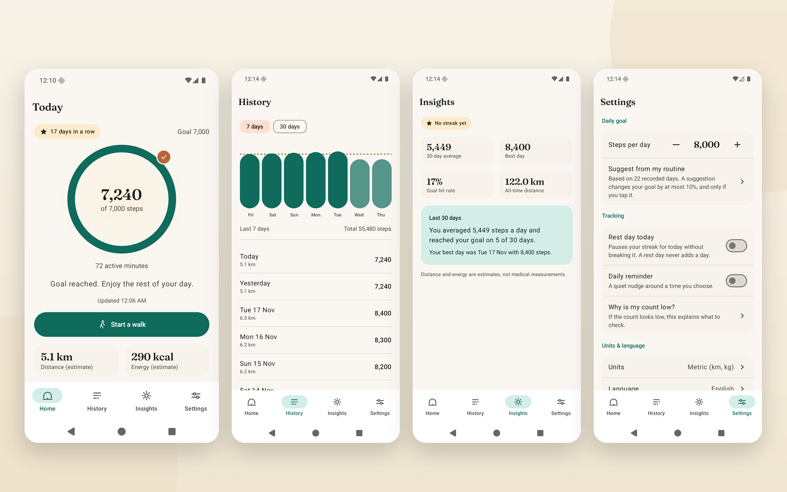
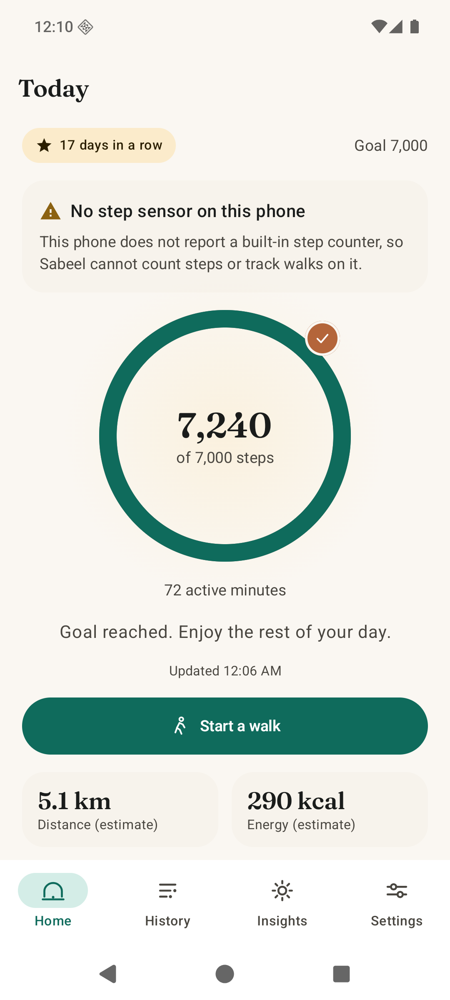
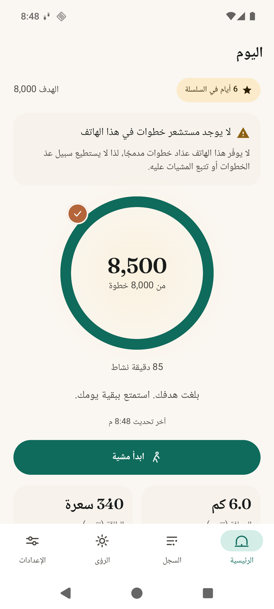
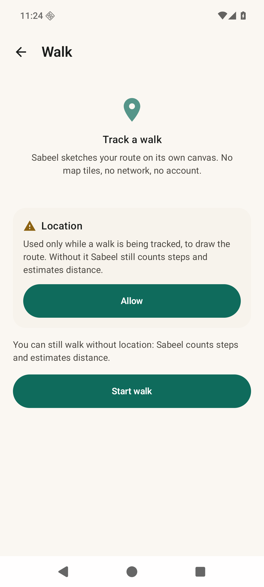
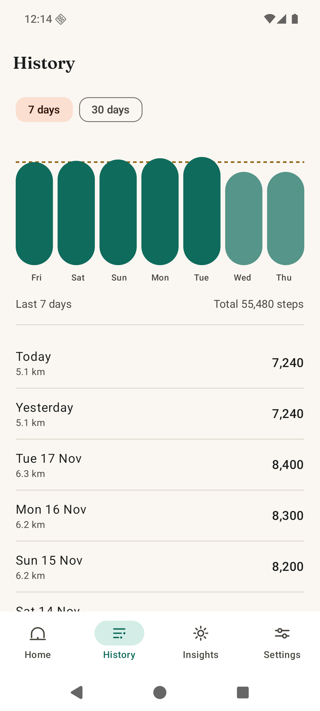
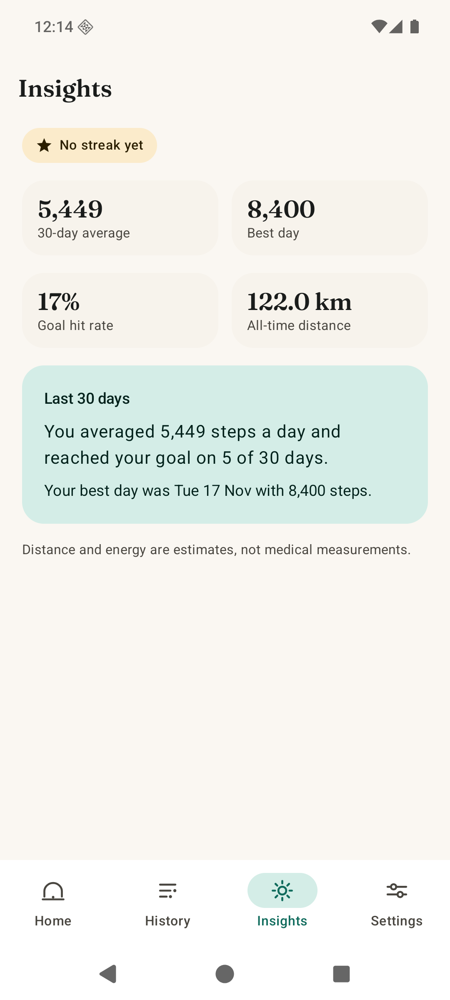

# Sabeel — سبيل

**An offline, ad-free step counter (pedometer) and walk/run tracker for Android — no INTERNET permission, no account, no ads, no analytics. English and Arabic.**

[](https://github.com/ahmadmhmdsy/sabeel-steps/releases/latest)
[](LICENSE)
[-3DDC84?logo=android&logoColor=white)](#compatibility)
[](#architecture)
[](#architecture)
[](https://github.com/ahmadmhmdsy/sabeel-steps/actions/workflows/android.yml)
[](#verification-status)

**English** | [العربية](README.ar.md)

<p align="center">
  
</p>

*Illustrative brand image — a designed mockup of the English UI, not a screenshot of measured device data or a device attestation. Real emulator captures are in [Screenshots](#screenshots).*

Sabeel (Arabic: **سبيل**) is an original, open-source (Apache-2.0) Android step counter and walk/run tracker that keeps everything on your phone. The merged manifest of the release build contains **no `INTERNET` permission**, so the app cannot send your data anywhere; there is no server, no account, no ad network, no analytics and no crash-reporting SDK. It has a small, honest feature set: today's steps against a personal goal, 7/30-day history, insights, optional walk/run sessions with an optional foreground route, locally saved places and presets, reminders, and a diagnostics screen that tells you whether counting is actually running. UI in **English and Arabic**.

- **Package / applicationId:** `com.sabeel.steps`
- **Version:** 1.3.0 (versionCode 3) — see [`app/build.gradle.kts`](app/build.gradle.kts)
- **Distribution:** **GitHub Releases only.** Sabeel is **not published on Google Play**; there is no Play listing, and no Play approval is claimed or implied.
- **Platform:** Android 8.0+ (minSdk 26); compileSdk/targetSdk 36.
- **Stack:** Kotlin 2.0.21 · Jetpack Compose (Material 3) · Room v3 (KSP) · DataStore · WorkManager · Navigation-Compose · AGP 8.10.1 · Gradle wrapper 8.11.1 · JDK 21.
- **License:** Apache-2.0 — [LICENSE](LICENSE), [NOTICE](NOTICE), [third-party notices](app/src/main/assets/THIRD-PARTY-NOTICES.txt).
- **Project website:** <https://ahmadmhmdsy.github.io/sabeel-steps/>

## Why Sabeel

- **Offline by construction, not by promise.** The release manifest has no `INTERNET` permission and no network code. Anyone can verify that from the APK or the merged manifest; it does not depend on a settings toggle.
- **No ads, no accounts, no tracking.** No ad SDK, no analytics, no crash reporter, no cloud sync, no subscriptions. Android cloud backup is disabled (`allowBackup="false"`), so your step data is not copied to Google's servers either.
- **Your data stays yours.** All records live in the app's private storage. You can export daily totals yourself through Android's document picker and delete everything from Settings; uninstalling removes it all.
- **Multiple step sources, fused honestly.** Hardware step counter + step detector + optional read-only Health Connect total + a clearly labelled accelerometer estimate. Each source keeps its own ledger; the day is the maximum of the evidence, and gaps are marked "≈" instead of being invented.
- **It admits what it cannot do.** Foreground-service counting can be stopped by Android or an aggressive OEM battery manager; Sabeel records the boot attempt, explains what happened in Diagnostics, and never claims "always counting".
- **Small, signed, rebuildable from source.** The v1.3.0 release APK is **2,138,010 B (2.04 MiB)**, signed, and its SHA-256 is published; you can rebuild it from source with the documented commands.
- **English and Arabic.** RTL layouts and translated strings in both directions. Native Arabic review is still pending (see [Honest limitations](#honest-limitations)).
- **Open source.** Apache-2.0; the full Kotlin source, tests, legal and release evidence are in this repository.

## Table of contents

- [Why Sabeel](#why-sabeel)
- [Download and install](#download-and-install)
- [Screenshots](#screenshots)
- [Features](#features)
- [Privacy and security model](#privacy-and-security-model)
- [Architecture](#architecture)
- [Build, test, lint](#build-test-lint)
- [Verification status](#verification-status)
- [Compatibility](#compatibility)
- [Honest limitations](#honest-limitations)
- [Deliberately not included](#deliberately-not-included)
- [Docs map](#docs-map)
- [Contributing and security](#contributing-and-security)
- [FAQ](#faq)
- [License](#license)

## Download and install

**Latest release:** <https://github.com/ahmadmhmdsy/sabeel-steps/releases/latest>

Each release page carries the signed artifacts and their checksums:

| Asset | What it is | Use it for |
|---|---|---|
| `Sabeel-1.3.0-release.apk` | Signed release APK (R8-minified, resource-shrunk) | Installing on a phone |
| `Sabeel-1.3.0-release.aab` | Signed Android App Bundle | Bundle tooling / a future Play upload — **not installable with `adb install`** |
| `SHA256SUMS.txt` | SHA-256 checksums for every v1.3.0 artifact | Verifying a download |

The same checksums are tracked in [`dist/SHA256SUMS.txt`](dist/SHA256SUMS.txt) (release binaries themselves are not committed; they are rebuilt from source).

### Verify the download

```powershell
# Windows PowerShell
Get-FileHash .\Sabeel-1.3.0-release.apk -Algorithm SHA256
```

```bash
# Linux / macOS
sha256sum -c SHA256SUMS.txt
```

The release APK must print:

```
487ee9c9f7e7d0e1bbe490c4b7692c72cb83c0f8d963cf1f2a4545677a4dfe5d  Sabeel-1.3.0-release.apk
```

### Install with adb (sideload)

```bash
adb install -r Sabeel-1.3.0-release.apk
```

Sideloading caveats, stated plainly:

- This is **not** a Play Store install. There is no Play listing and no automatic update channel; when a new version ships, download and install the new APK over the old one (same signing key, so it updates in place).
- You need USB debugging enabled, or a file manager allowed to "install unknown apps". Android may show the standard unknown-source and Play Protect warnings; they are expected for any app distributed outside a store.
- Use `adb install`, not `adb sideload` — the latter is for recovery/OTA-style images and is not a normal app install.
- Requires Android 8.0 (API 26) or newer.

## Screenshots

| | | |
|---|---|---|
|  |  |  |
|  |  | |

**These are emulator captures**, taken at 1080×2400 on the **API 36 AOSP-ATD test image** used for this project's QA. That image has **no hardware step counter or step detector**, so the Home screens show Sabeel's "No step sensor" notice instead of live hardware steps, and some QA flows used the debug-only step injector. The captures show the real UI and real layouts; they are **not** evidence of real step counting, and **no physical-device screenshots of v1.3 exist yet**.

## Features

*Everything below is present in the v1.3.0 build. Features exercised only on debug builds or only on the emulator are marked; see [Verification status](#verification-status).*

### Counting control and boot evidence

- **One persisted on/off switch** for step counting, shared by the Home ring, the status pill under it and Settings — the same switch everywhere, with a switch role for TalkBack. The choice survives reboot and app restart.
- When counting is off, the counting service is not running and the UI says so; Diagnostics distinguishes "off by user" from "stopped by the system".
- **Boot restart evidence:** after a restart, `BootReceiver` records the boot attempt (flags, activity/Health Connect permissions, sensor, result, whether the service was alive after a check) and tries to resume counting if it was on. If Android blocks the background start, the app records it and may post **one** quiet recovery notification. Diagnostics lists the last ten attempts.
- **Share diagnostics:** a text report with no location or saved-place data.
- **One-tap "Restart counting"** button in Diagnostics.

### Step sources

- `TYPE_STEP_COUNTER` and `TYPE_STEP_DETECTOR` run in parallel in a health foreground service.
- **Health Connect** (optional, read-only, off by default) contributes today's synced step total as an absolute floor; an optional, feature-gated background read keeps it fresh. Sabeel **never writes** to Health Connect.
- A clearly labelled **accelerometer estimate** fills only the part no measured or synced source has seen. Each source keeps its own ledger; nothing is switched or re-based; the day is the maximum of the evidence.
- Reboots and sensor resets are detected from a falling raw value; impossible jumps are rejected; counter catch-up after process death is recovered from the cumulative raw. The "≈" marker is derived from the ledgers and persisted with the day.

### Walk and run sessions

- Start a walk or run from Home with an optional goal: time, steps, distance, or arrival at a **saved place**.
- Optional foreground route and distance, recorded only while the session screen is open and only with location permission; pause/resume without back-filling the paused period; finish/save or discard.
- **One active session at a time**; sessions crossing midnight are split into legs.
- Session steps are a **projection of the same global day count**, never a second counter — `session.steps ≤ daily.steps` by construction.
- Saved **presets** reuse a usual session setup. **Places** are local label + latitude/longitude + radius (25–1000 m), with an external Maps link; there is no address search, no geocoding and no map-tile download.
- **Session export:** "Export all sessions (CSV)" and per-session "Export GPX" through the system document picker — present in the build and exercised on an emulator debug build, not yet validated on the release-signed build or a phone.

### Home, History, Insights

- **Home:** progress ring against your personal goal, today's steps, distance, active minutes, streak and 7-day bars. The ring is the counting switch.
- **History:** 7/30-day history with a goal line, daily list, and your saved sessions with their labels and exports.
- **Insights:** window averages, best day, goal-hit rate and total distance.

### Reminders, notifications, settings

- Reminders via WorkManager, plus a goal-reached notification you can tap to open the app (`POST_NOTIFICATIONS`-aware; denial does not crash).
- **Settings:** counting switch, daily goal, units, reminder, body data used for estimates, language (English/Arabic), CSV export/import of daily totals through Android's document picker, and **Delete all data**.
- **Privacy** and **About** screens that state what is stored on the device and what the app can and cannot do.
- **Language:** full English and Arabic UI, including the new session screens.

## Privacy and security model

**The provable claim:** the merged manifest of the release build contains **no `INTERNET` permission** and no `ACCESS_NETWORK_STATE`; there is no server, no account system, no ads, no analytics, no crash-reporting SDK, and no cloud sync. Sabeel cannot transmit your data — it has no transport and no permission to build one.

### Permissions the app does use

| Permission | Why | Notes |
|---|---|---|
| `ACTIVITY_RECOGNITION` (runtime, API 29+) | Read the hardware step counter/detector | Explained before the system prompt; core feature |
| `POST_NOTIFICATIONS` (runtime, API 33+) | Reminders, goal notification, the counting foreground-service notification | Optional; denial does not crash |
| `ACCESS_FINE_LOCATION` / `ACCESS_COARSE_LOCATION` (runtime) | Optional route/distance during a session you start | **Foreground only**; requested at session start; declining keeps sessions usable |
| Health Connect `READ_STEPS` (+ optional feature-gated background read) | Optional read-only source of today's synced step total | Off by default; never writes; revocable |
| `FOREGROUND_SERVICE`, `FOREGROUND_SERVICE_HEALTH`, `FOREGROUND_SERVICE_LOCATION` | Step counting and active-session services show a notification | Normal permissions |
| `RECEIVE_BOOT_COMPLETED` | Attempt to resume counting/reminders after restart and record the boot attempt | Normal permission; the attempt can be blocked by Android |
| `WAKE_LOCK` | WorkManager scheduling | Transitive; not user-visible |

**Absent by design and verified in the v1.3 release manifest:** `INTERNET`, `ACCESS_NETWORK_STATE`, `ACCESS_BACKGROUND_LOCATION`, `BODY_SENSORS`, storage/media permissions, exact-alarm permissions and `AD_ID`.

### Data handling

- Step totals, sessions/legs, routes, places, presets and preferences are stored in the app's private storage (Room + DataStore) and protected by Android's app sandbox; the app adds no network or cloud layer of its own.
- **Android cloud backup is disabled** (`allowBackup="false"`).
- **Health Connect is read-only and opt-in**: Sabeel reads today's total only, never writes, and the grant can be revoked in Health Connect or Android Settings at any time.
- **Location stays foreground-only**: no background location, no geofencing, no location at boot, no map or geocoding requests.
- **The only data that leaves the app is a file you export yourself** (daily-total CSV, or session CSV/GPX where present) through Android's document picker. The developer never receives it.
- **Delete all data** in Settings removes the database (daily steps, sessions/legs, routes, places, presets), preferences and files; uninstalling removes everything. No account exists, so no account-deletion flow is needed.
- **No telemetry:** there is no analytics or crash reporting by design. Bug reports are manual.

### Release integrity

- Release builds are R8-minified and resource-shrunk, signed with the project's upload key (APK signature scheme v2; certificate SHA-256 `7b12ad6b…6152d`). The AAB is signed with the same key.
- Every artifact's size and SHA-256 are published (see [Verification status](#verification-status)); verify before installing.
- Signing procedure and key-handling policy: [`docs/release/KEYSTORE.md`](docs/release/KEYSTORE.md). Secrets are never committed.
- Security policy and private vulnerability reporting: [SECURITY.md](SECURITY.md).

## Architecture

```
app/src/main/java/com/sabeel/steps/
  domain/     pure Kotlin: models, step math, step pipeline, window math
  domain/session/  activity/goal types, place/preset/leg models, projection rules
  data/       Room DB + DAOs (v3), repositories, DataStore settings, CSV codec/IO,
              export/session folder (SessionExport CSV/GPX builders)
  service/    StepCounterService (health FGS), WalkTrackingService (location|health FGS),
              WalkTracker (live state + checkpoint), CountingController (persisted intent),
              SessionConfig (session request carried in the service Intent)
  platform/   permissions, notifications, reminders/workers, BootReceiver,
              BootHealthWorker, CountingStore, service status store
  ui/         Compose theme/components/screens, view models, i18n (EN/AR)
app/src/debug/  DebugStepReceiver — debug-only step injector for emulator QA
app/src/test/   JVM unit tests (pipeline, math, CSV, session projection/export, cadence)
```

**Data flow:** sensor events → `StepPipeline` (per-source ledgers, fused day) → `StepsRepository` (one atomic snapshot write) → Room; a session's live steps are re-derived from the day rows plus its own baseline; user settings → DataStore. Nothing leaves the device: no `INTERNET` permission, no networking code, no SDKs.

**Room v3** adds `Place`, `SessionPreset` and `WalkLeg` tables with the exported `MIGRATION_2_3`; schema JSON is committed and there is no destructive fallback.

## Build, test, lint

Prerequisites: **JDK 21**, Android SDK platform 36 + build-tools 36, and the included Gradle wrapper (do not install Gradle separately). Windows PowerShell example:

```powershell
$env:JAVA_HOME='C:\Program Files\Eclipse Adoptium\jdk-21.0.13.9-hotspot'
$env:ANDROID_HOME='C:\Android\Sdk'
$env:ANDROID_SDK_ROOT=$env:ANDROID_HOME

.\gradlew.bat --console=plain :app:assembleDebug          # debug APK
.\gradlew.bat --console=plain :app:testDebugUnitTest      # unit tests
.\gradlew.bat --console=plain :app:lintDebug              # lint gate (must be exit 0)
.\gradlew.bat --console=plain :app:assembleRelease        # release APK
.\gradlew.bat --console=plain :app:bundleRelease          # AAB for Play
```

Outputs:

- Debug APK: `app/build/outputs/apk/debug/app-debug.apk`
- Release APK: `app/build/outputs/apk/release/app-release.apk`
- Release AAB: `app/build/outputs/bundle/release/app-release.aab`
- Unit-test report: `app/build/reports/tests/testDebugUnitTest/index.html`
- Lint report: `app/build/reports/lint-results-debug.html`

**CI:** [`android.yml`](.github/workflows/android.yml) runs `assembleDebug`, `testDebugUnitTest`, `lintDebug` and an **unsigned** `bundleRelease` on every push to `main`; the badge reports the latest run. CI is a build gate, not a substitute for the measured release table below.

### Emulator QA and fake steps

The API 36 AOSP-ATD image has **no hardware step counter or detector**, so real counting cannot be validated there; use a physical phone for that (script: [`docs/release/TEST-XIAOMI.md`](docs/release/TEST-XIAOMI.md)). On a **debug** build only, a broadcast receiver injects steps through the same snapshot path the service uses:

```powershell
adb shell am broadcast -a com.sabeel.steps.DEBUG_STEPS --ei steps 100 -n com.sabeel.steps/.debug.DebugStepReceiver
```

The receiver is absent from release builds. On the emulator, location can be simulated with `adb emu geo fix <lon> <lat>`.

### Release signing and the privacy-policy URL

Release signing loads from `keystore.properties` only when that file exists, so CI and fresh clones still build (unsigned) release artifacts. Procedure: [`docs/release/KEYSTORE.md`](docs/release/KEYSTORE.md). The in-app privacy-policy link is a `BuildConfig` field supplied at build time with `-Psabeel.privacyPolicyUrl=…`; without it the value is empty and the in-app link must stay hidden. Hosting steps: [`docs/privacy-site/FILL-AND-HOST.md`](docs/privacy-site/FILL-AND-HOST.md).

## Verification status

**Measured 2026-11-23.** The v1.3.0 build was produced in one serialized Gradle run on JDK 21 (Temurin 21.0.13), Android SDK platform 36, build-tools 36.0.0, Gradle wrapper 8.11.1 and AGP 8.10.1. No release artifact was rebuilt after that run. Every number below comes from the command named next to it; no count, size or hash is copied from a plan or a claim.

| Check | Result | Command / evidence |
|---|---|---|
| JVM unit tests | **205 tests, 18 suites, 0 failures, 0 skipped** (exit 0, 7m14s) | `:app:testDebugUnitTest --no-daemon` |
| Lint gate | **0 errors, 80 warnings, 2 hints** (exit 0, 6m04s) | `:app:lintDebug --no-daemon` |
| Release APK | **2,138,010 B (2.04 MiB)**, SHA-256 `487ee9c9f7e7d0e1bbe490c4b7692c72cb83c0f8d963cf1f2a4545677a4dfe5d`; signed, `apksigner verify` exit 0, `zipalign -c -P 16` OK; versionCode 3 / versionName 1.3.0; not debuggable | `:app:assembleRelease` |
| Release AAB | **4,608,495 B (4.40 MiB)**, SHA-256 `ffde823d8855a7d2e8f3987156dd93124c89cf2e92894e310ba01f43a4a9fc4e`; `jarsigner -verify` exit 0 | `:app:bundleRelease` |
| Release manifest audit | No `INTERNET`, no `ACCESS_NETWORK_STATE`, no background location, no body sensors, no storage/media, no exact alarms, no `AD_ID`; FGS types health and location\|health; `allowBackup="false"` | `aapt2 dump permissions` + merged release manifest |
| Emulator smoke | Debug v1.3: reboot with counting ON restarted the FGS (`Result: STARTED`), reboot with counting OFF stayed off, ring toggle, session pause/resume, CSV/GPX export, place auto-stop + goal notification; release-signed APK installed and completed onboarding + Home + one session on a clean API 36 emulator | Emulator QA notes in [CHANGELOG.md](CHANGELOG.md) (1.3.0 "Evidence at the time") |
| Physical device | **None for v1.3.** No physical-device run of this version exists. The last physical-device plan is still pending: [`docs/release/TEST-XIAOMI.md`](docs/release/TEST-XIAOMI.md) | — |
| Google Play | **Not published.** No listing, no testing track, no review. | — |
| Native Arabic review | **Pending** — translations and RTL layouts exist, but no native speaker has signed them off | — |

**What this table does not prove:** that v1.3.0 counts real steps on a real phone, that the session flow behaves the same under a real OEM battery manager, or that the store submission will be accepted. Those are explicitly pending (see below).

**Historical note:** the pre-v1.3 build kept versionName 1.1.0 / versionCode 2 even though the step-manifold work was called "v1.2" in the planning docs; no 1.2.0 artifact exists. Its numbers (127 tests, APK 1,864,306 B) are **not** v1.3 evidence and are not carried forward. Details: [CHANGELOG.md](CHANGELOG.md).

## Compatibility

| Item | Requirement |
|---|---|
| Android version | **Android 8.0 (API 26)** or newer; compileSdk/targetSdk 36 |
| Step counting | Needs a hardware step counter (`TYPE_STEP_COUNTER`) and/or step detector (`TYPE_STEP_DETECTOR`); the two are fused, and Health Connect can supply today's synced total if enabled |
| Without a hardware sensor | The app can still show a clearly labelled accelerometer estimate ("≈") and, if available, a read-only Health Connect total; test images with no motion sensors show a "No step sensor" notice instead of counting |
| Health Connect | Optional, read-only, off by default; only where Health Connect is installed (built into Android 14 and newer; available as an app on older supported versions) |
| Location (optional) | Foreground only, during a session you start; needs device location services; denial keeps sessions usable without a route |
| Notifications | Optional on Android 13+; used for reminders, the goal notification and foreground-service notices |
| Data storage | Local Room database + DataStore; CSV via Android's document picker (no storage permission); export files go wherever you send them |
| Backup | Android cloud backup disabled; data is not synced or restored by Google |

## Honest limitations

These are real, not fine print. If a claim in this README is not backed by the table above, treat it as pending.

- **v1.3.0 is built and tested but not device-verified.** Validation is the 205-test JVM suite, lint, signed R8 release builds and emulator-only runs on the API 36 AOSP-ATD image. **No physical-device run of v1.3 exists**, so "v1.3 behaviour" means "the behaviour this release is built to deliver", not device evidence.
- **Not on Google Play.** Distribution is GitHub Releases only: no Play listing, no Play review, no automatic updates and no store-mediated trust signal. Sideload warnings are expected.
- **Counting cannot be guaranteed.** No Android app can restart itself after a force-stop, and OEM battery managers (MIUI and others) can stop a foreground service. Sabeel tries at boot, records the attempt, may post one recovery notification and tells you when it was blocked; it never claims "always counting".
- **The detector/counter fusion still needs the Step Zero falsification test on a real phone** ([`COUNCIL.md`](docs/review/2026-11-21/step-resilience/COUNCIL.md)). If the step detector disagrees with the counter beyond tolerance on hardware, the detector is demoted to liveness-only. Process death cannot recover detector-only steps taken while the process was dead (the hardware counter can); Health Connect fills that gap only when granted.
- **The Health Connect read path has not been validated against real Health Connect data.** It is unit-tested and its screens were captured on the emulator, but the test image had no Health Connect step data. A phone whose watch/app writes steps to Health Connect is still needed to validate the read, the floor reconciliation and the optional background read. Health Connect has no step timestamps, so an HC-only day contributes no active minutes.
- **Estimates are estimates.** Accelerometer-based steps, distance, active minutes and calories are approximations from phone sensors (and optionally Health Connect), not medical measurements. The estimate cannot distinguish walking from some hand-carried or handshake motion. Sabeel is not a medical device and does not diagnose, treat, cure or prevent anything.
- **Location is foreground-only.** A route is recorded only while the session screen is open and only with permission; distance can pause while you are away from the screen even though steps and time continue. There is no background location, no geofencing, no map download and no address search — saved places are a label plus coordinates on the phone.
- **Sessions, places and session export are emulator-exercised, not device-verified.** The session flow, place creation with a goal/auto-stop, and CSV/GPX export were exercised on a debug build on an emulator; the release-signed build passed only an install/onboarding/Home/session smoke test. Repeat on a physical phone before relying on them.
- **Arabic is translated but not natively reviewed.** EN/AR key parity holds and RTL layouts exist; no native Arabic speaker has signed the strings off, and RTL layout of the new session screens still needs a device check. Native review remains a launch precondition. Report awkward Arabic wording via an issue.
- **CSV details:** CSV covers **daily totals**, not sessions. The v1.1+ format adds a sixth `estimated_steps` column; five-column v1.0 files still import (the estimate is stored as 0), but other apps that parse the CSV may need the new header.
- **Release-only caveats:** R8 minification is applied to release builds; repeat the emulator smoke list on a physical device before uploading anywhere. Store assets (screenshots, feature graphic, FGS demo video) are not ready, and the Play declarations and listing copy exist only as drafts ([PLAY-1.3.md](docs/release/PLAY-1.3.md)).
- **No analytics or crash reporting by design**, so release verification must come from manual runs (and, if it is ever published, store vitals) — not from telemetry.

## Deliberately not included

Sabeel does **not** have, and v1.3.0 does not add: accounts or sign-in, cloud sync, ads, subscriptions or in-app purchases, social features or leaderboards, Health Connect **write/export**, background location, map tiles or address search, home-screen widgets, simultaneous sessions, analytics, crash reporting, or any third-party network SDK.

The optional Health Connect integration only **reads** today's step total. Reading steps from Health Connect is an offline, opt-in fallback; the app never writes to Health Connect and never shares the total.

## Docs map

| Path | Contents |
|---|---|
| [README.md](README.md) · [README.ar.md](README.ar.md) | This document, English and Arabic |
| [CHANGELOG.md](CHANGELOG.md) | Version history and measured evidence per release |
| [docs/release/NOTES-1.3.md](docs/release/NOTES-1.3.md) | User-facing v1.3 release notes (EN + AR) |
| [docs/release/GITHUB-RELEASE-1.3.md](docs/release/GITHUB-RELEASE-1.3.md) | Body of the GitHub Release v1.3.0 (this release's notes) |
| [docs/release/PLAY-1.3.md](docs/release/PLAY-1.3.md) | Draft Play Console answers, declarations and listing copy — **nothing submitted** |
| [docs/release/CLAIMS-AUDIT.md](docs/release/CLAIMS-AUDIT.md) | Per-claim evidence audit |
| [docs/release/TEST-XIAOMI.md](docs/release/TEST-XIAOMI.md) | Physical-device test script (pending owner run) |
| [docs/release/KEYSTORE.md](docs/release/KEYSTORE.md) | Release signing and Play App Signing procedure |
| [docs/legal/privacy-policy.md](docs/legal/privacy-policy.md) | Privacy policy source (hosting pending) |
| [docs/privacy-site/](docs/privacy-site/) | Static, tracker-free privacy page + [hosting instructions](docs/privacy-site/FILL-AND-HOST.md) |
| [docs/legal/BLOCKERS.md](docs/legal/BLOCKERS.md) | Owner blockers (policy hosting, name clearance, Play account, store assets) |
| [docs/legal/HARDWARE-QA-CHECKLIST.md](docs/legal/HARDWARE-QA-CHECKLIST.md) | Hardware QA checklist (Health Connect §5b, step sensor) |
| [docs/product/spec.md](docs/product/spec.md) · [brief.md](docs/product/brief.md) | Product brief and locked engineering spec |
| [docs/review/](docs/review/) | Independent review reports and fix evidence |
| [dist/SHA256SUMS.txt](dist/SHA256SUMS.txt) | Tracked checksums for the v1.3.0 (and historical 1.1) artifacts |
| [.github/workflows/android.yml](.github/workflows/android.yml) | CI: build + unit tests + lint + unsigned bundle |

## Contributing and security

- **Contributing:** read [CONTRIBUTING.md](CONTRIBUTING.md) before opening a pull request. The project is a small, release-focused effort; changes that add network permissions, ads, analytics, cloud sync or third-party data SDKs will be rejected because they would falsify the app's only provable privacy claim. Coding style, commit expectations and the review process live in that file.
- **Security:** please report vulnerabilities privately as described in [SECURITY.md](SECURITY.md) — do not open a public issue for a security problem. The attack surface is intentionally small (no network permission, no server, no third-party SDKs), but local data handling, exports and the Health Connect/location permissions still deserve review.

## FAQ

**Does Sabeel need an internet connection?**
No. The release manifest has no `INTERNET` permission, there is no server, no account and no network SDK. The app works in airplane mode. The only data that leaves the app is a file you export yourself through Android's document picker.

**Is Sabeel available on Google Play?**
No. As of v1.3.0 (built and measured 2026-11-23) Sabeel is distributed **only from GitHub Releases**. There is no Play listing and no Play review; nothing here implies Play approval. Updates are manual APK installs over the same signing key.

**How can I verify the "no internet" claim myself?**
Inspect the downloaded release APK's manifest (for example with `apkanalyzer manifest permissions Sabeel-1.3.0-release.apk` or `aapt2 dump permissions`), or read the merged release manifest in the build output. `INTERNET` and `ACCESS_NETWORK_STATE` are absent. The source contains no networking code; the same audit is recorded in [PLAY-1.3.md §7](docs/release/PLAY-1.3.md).

**What if my phone has no step sensor?**
Where a hardware step counter or detector exists, Sabeel fuses them. Without one it can show a clearly labelled accelerometer estimate ("≈") and, if you enable it, today's total read from Health Connect. Emulators and bare test images with no motion sensors show a "No step sensor" notice and cannot count — use a physical phone.

**Is Health Connect required? Does Sabeel write to it?**
No and no. Health Connect is optional, off by default, and **read-only**: Sabeel reads today's Steps total as a floor and never writes, never requests write permissions and never shares it. You can decline or revoke it at any time and the app remains fully usable.

**Why do steps stop counting sometimes, and can Sabeel restart itself?**
Android does not allow an app to restart itself after a force-stop, and some OEM battery managers stop foreground services. Sabeel attempts to resume at boot, records what happened, may post one recovery notification and shows the state in Diagnostics — but no app can bypass those rules, so Sabeel never claims "always counting". See [Honest limitations](#honest-limitations).

**Are the step counts accurate? Is this a medical app?**
The counts are estimates from phone sensors (and optionally Health Connect), with the accelerometer tier explicitly marked "≈". Distance, active minutes and calories are derived estimates. Sabeel is not a medical device and makes no diagnosis, treatment, cure or prevention claims; consult a qualified professional for health advice.

## License

Licensed under the **Apache License 2.0** — see [LICENSE](LICENSE). Copyright and attribution details are in [NOTICE](NOTICE); third-party component notices are in [app/src/main/assets/THIRD-PARTY-NOTICES.txt](app/src/main/assets/THIRD-PARTY-NOTICES.txt).

Sabeel is an independent, original project built clean-room from public product research: no decompilation, no copied assets, and no copied copy. It is not affiliated with, endorsed by, or derived from any other step-counter app.
